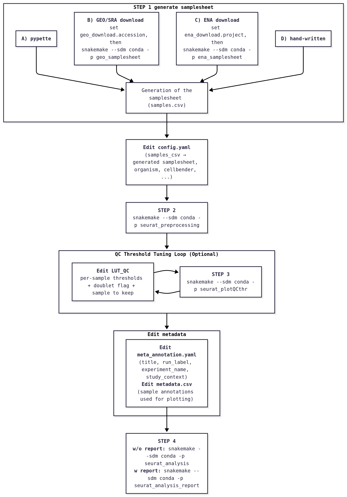

# scRNASeq_COSR_Standard_Workflow

This is the standard scRNASeq workflow at the Center of Genomics Sciences @OSR: [COSR](https://research.hsr.it/en/centers/omics-sciences.html).
This streamlined process enables comprehensive analysis of single-cell data, from raw sequences to insightful biological interpretations.

The workflow begins by processing raw scRNA-Seq fastq.gz files typically generated from Illumina sequencers and 10x Chromium 3' libraries. Cell x gene matrices, generated by [Cellranger](https://www.10xgenomics.com/support/software/cell-ranger/latest) v10 starting from the fastq files serve as the foundation for further analysis.

A series of quality control (QC) filters and checks is applied to each sample to evaluate data integrity. 
After individual sample analysis, the samples are first merged to assess for the prence of potential batch effects and then integrated. Integration is performed using Seurat's v5.1.0 anchoring procedure to minimize batch effects and highlight meaningful biological differences. The merged and integrated datasets are then characterzied to produce: unbiased clustering across all samples, UMAP visualizations and Cluster-specific marker identification.

The workflow has been developed using modules of snakemake files developed by the scRNASeq team at [COSR](https://research.hsr.it/en/centers/omics-sciences.html).

## Table of contents

- [Version updates](docs/version_updates.md)
- [Requirements](docs/requirements.md)
- [Quick guide](#quick-guide)
- [Setup](docs/setup.md)
  - [1. Generate the input samplesheet](docs/setup.md#1-generate-the-input-samplesheet)
  - [2. run cellranger](docs/setup.md#2-run-cellranger)
  - [3. Cellbender module](docs/setup.md#3-cellbender-module)
  - [4. run Seurat](docs/setup.md#4-run-seurat)
- [Cloupe file](docs/cloupe_file.md)
- [Take a look at the rule DAG](docs/rule_dag.md)
- [Sections](docs/sections.md)

## Quick guide

The pipeline is a sequence of stopping points: generate a samplesheet, configure the run, preprocess, fill in QC thresholds, then run the final analysis.

Summarised as steps:
1. Obtain a `samples_csv` (four interchangeable options, pick one): run `pypette`, run the [GEO/SRA download module](docs/setup.md#option-b-geosra-download) (`geo_samplesheet`), run the [ENA download module](docs/setup.md#option-c-ena-download) (`ena_samplesheet`, for reads that are in ENA but not in SRA), or hand-write a `samplesheet.csv` (columns: `sample_name`, `sample_run`, `sample_path`).
2. Point `samples_csv` in `config/config.yaml` at that file, then adjust the rest of the config for the run: `ref`/`organism_id` (species), `run_cellbender` (True/False), `out_location`, `annotation_methods` (which automatic cell-typing method(s) to run — see [Automatic Annotation](docs/setup.md#automatic-annotation)), and any other project-specific parameters (transgene, metadata, etc.). Then run the `seurat_preprocessing` rule (**STEP 2**) to generate the single sample RDS and QC plots before filtering. This is the first stopping point: the user should fill the look up table (`LUT_QC_<tag>.csv`) for the filtering parameters, and edit `metadata/metadata.csv` (generated once, with placeholder `"all"` values for each column in `config["report"]["sample_annotations"]`, and never regenerated afterwards) with the real per-sample annotations, since it is later used by `reportImages` to split UMAP plots by sample annotation. `metadata/metadata.csv` lists every sample in `samples_csv` and is independent of `LUT_QC_<tag>.csv`, so the two can be edited in either order: `reportImages` automatically restricts the annotations to whichever samples are still `include_sample = TRUE` in `LUT_QC_<tag>.csv` at run time, ignoring rows for any sample you later exclude.
3. QC threshold tuning loop (optional): edit `LUT_QC_<tag>.csv` and run `seurat_plotQCthr` (**STEP 3**) to regenerate the QC plots with the thresholds highlighted, sanity-checking and re-editing as many times as needed before applying any filter. `LUT_QC_<tag>.csv` also has an `include_sample` column (default `TRUE`): set it to `FALSE` to drop a whole sample from merge/integration onward (e.g. a failed run) — `runApplyQC` still QC-filters it individually so its outputs remain available for review, but `integrateSamples` excludes it before merging, and `seurat_plotQCthr`'s regenerated plots mark it with an `[EXCLUDED]` facet label so it's still visible for comparison. `reportImages` applies the same `include_sample` filter to `metadata/metadata.csv` before joining it onto the merged/integrated objects, so revisiting `include_sample` later never leaves stale annotation rows for excluded samples. When editing `LUT_QC_<tag>.csv`, also review `config/meta_annotation.yaml` (title, run_label, experiment_name, study_context), since it is submitted as metadata to the CyteTypeR cell type annotation service and should stay consistent with the current run/sample scope.
4. Run the "last rule" (**STEP 4**). Currently it is called `seurat_analysis` and produces the QC-filtered, integrated, annotated result. This runs the whole DAG from cellranger to integration (or resumes from the last stopping point).

What happens when calling the current "last rule" `seurat_analysis` instead of **STEP2**? Currently, the way it is implemented, the jobs are planned correctly from cellranger to integration, with all default parameters (all open filters).

5. Run `snakemake seurat_analysis_report` to produce the standard report.
